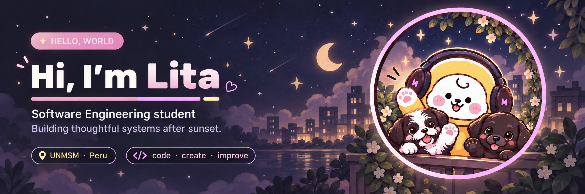
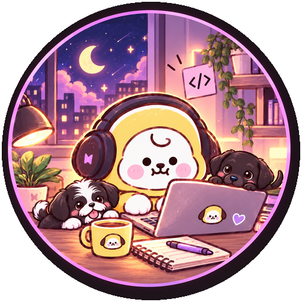
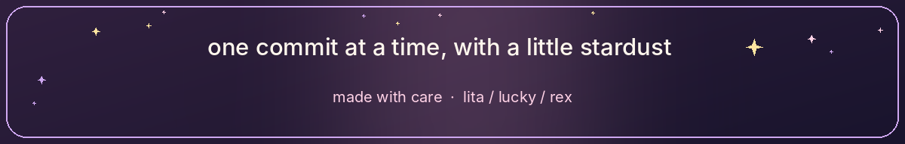

<div align="center">



<br />


**A little bit of logic, a little bit of imagination, and a lot of curiosity.** ✨

</div>


<a name="about"></a>

<a name="about"></a>

<a name="about"></a>

<div align="left">

<sub>✦ GET TO KNOW ME</sub>


</div>

<table>
<tr>
<td width="70%" valign="top">

<p>
  <strong>Hi, I'm Lita!</strong> Software Engineering student
  who enjoys building ideas from concept to implementation.
</p>


<ul>
  <li>
    
    <b>Education:</b> 8th-semester Software Engineering student at UNMSM, Peru.
  </li>

  <li>
    
    <b>Interests:</b> Frontend development, UX/UI, and full-stack applications.
  </li>

  <li>
    
    <b>My approach:</b> Understand requirements, design solutions, then build and test.
  </li>

  <li>
    
    <b>I also enjoy:</b> Databases, backend development, APIs, and automation.
  </li>

  <li>
    
    <b>Currently exploring:</b> AI, N8N, GitHub Actions, and Uptime Kuma.
  </li>
</ul>


</td>

<td width="30%" align="center" valign="middle">



</td>
</tr>
</table>


<a name="toolbox"></a>

<div align="left">

<sub>✦ TECHNOLOGIES & TOOLS</sub>


</div>


<sub>Technologies and tools I've worked with, organized by how I use them.</sub>

#### ✧ Languages


#### ✧ Frontend & UI


#### ✧ Backend & APIs


#### ✧ Databases & Data


#### ✧ DevOps & Workflow


<details>
<summary><b>✧ More things I've explored</b></summary>

<br>


</details>


<a name="beyond"></a>

<div align="left">

<sub>✦ OFF THE CLOCK</sub>


</div>

A little more about life outside the code.

<p>
  
  &nbsp; <b>Gaming</b> — A bit of competitive fun.
</p>

<p>
  
  &nbsp; <b>Music</b> — BTS on repeat.
</p>

<p>
  
  &nbsp; <b>My sidekicks</b> — Lucky & Rex.
</p>

<p>
  
  &nbsp; <b>Cozy nights</b> — A little peace after sunset.
</p>

<br>

<details>
<summary><b>✧ Open my developer note</b></summary>

<br>

```ts
const lita = {
  soundtrack: "BTS",
  downtime: "Gaming",
  companions: ["Lucky", "Rex"],

  favoriteBuilds: [
    "thoughtful interfaces",
    "well-designed systems"
  ],

  mindset: [
    "Understand",
    "Design",
    "Build",
    "Test",
    "Improve"
  ]
} as const;
```

</details>

<br>

<div align="center">



<sub>Thanks for visiting my little corner of GitHub! ♡</sub>

</div>

