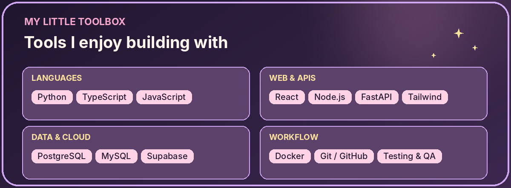
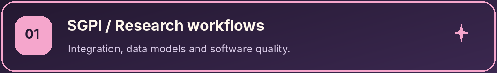
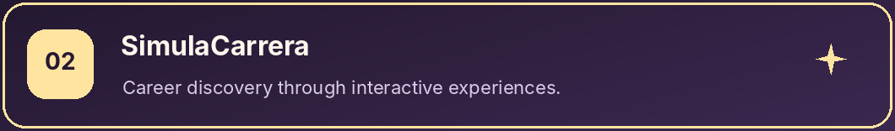
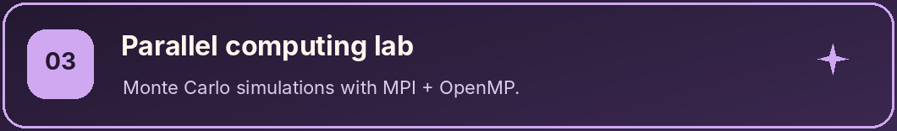

<div align="center">


<br />

**A little bit of logic, a little bit of imagination, and a lot of curiosity.** ✨

[About me](#about) · [Toolbox](#toolbox) · [Projects](#projects) · [Beyond the IDE](#beyond)

</div>


<a name="about"></a>

## ✦ A little about me

<table>
<tr>
<td width="67%" valign="top">

<p><strong>¡Hola! I'm Lita</strong> — a Software Engineering student at <strong>Universidad Nacional Mayor de San Marcos (UNMSM)</strong>, Peru. 🌙</p>
<p>I enjoy transforming ideas into thoughtful software: understanding the problem first, designing a solid foundation, and then making everything work together.</p>
<ul>
  <li>🌷 <strong>I gravitate toward:</strong> backend development, APIs, databases, software quality and automation.</li>
  <li>🧩 <strong>I believe in:</strong> planning before coding, clean data models and continuous improvement.</li>
  <li>🚀 <strong>I'm exploring:</strong> data analytics, parallel computing and practical AI applications.</li>
  <li>💫 <strong>Currently:</strong> learning, building and getting a little better with every project.</li>
</ul>
<p><em>“Good software starts with good questions.”</em></p>

</td>
<td width="33%" valign="middle" align="center">

</td>
</tr>
</table>


<a name="toolbox"></a>

## ✦ My little toolbox

<div align="center">

</div>

<sub>My toolbox is always growing — these are technologies I've worked with or am actively learning.</sub>


<a name="projects"></a>

## ✦ Things I'm building

A few academic and personal ideas that reflect what I love to learn:



**Research-management systems · Team project**  
Integrating institutional processes, improving traceability, and thinking carefully about data models, APIs and quality.



**Career exploration · Startup concept**  
An idea for helping students discover career paths through interactive simulations and useful guidance.



**High-performance computing · University project**  
Exploring flood simulation with Monte Carlo methods, MPI, OpenMP and parallel performance metrics.

<!-- When ready, add links to public repos below each project. -->


<a name="beyond"></a>

## ✦ Beyond the IDE

When I'm not thinking about endpoints or databases, you'll probably find me:

🎮 Playing video games &nbsp; · &nbsp; 🎧 Listening to BTS &nbsp; · &nbsp; 🐾 Hanging out with **Lucky & Rex** &nbsp; · &nbsp; 🌙 Enjoying a cozy night

<details>
<summary><b>☕ Open my tiny developer note</b></summary>
<br />

```ts
const lita = {
  loves: ['thoughtful software', 'BTS', 'gaming', 'Lucky & Rex'],
  curiousAbout: ['backend', 'quality engineering', 'data'],
  mindset: 'Learn → Build → Test → Improve',
  favoriteTimeToCode: 'after sunset 🌙'
};
```

</details>

<div align="center">


<sub>Thanks for visiting my little corner of GitHub! ♡</sub>

</div>
